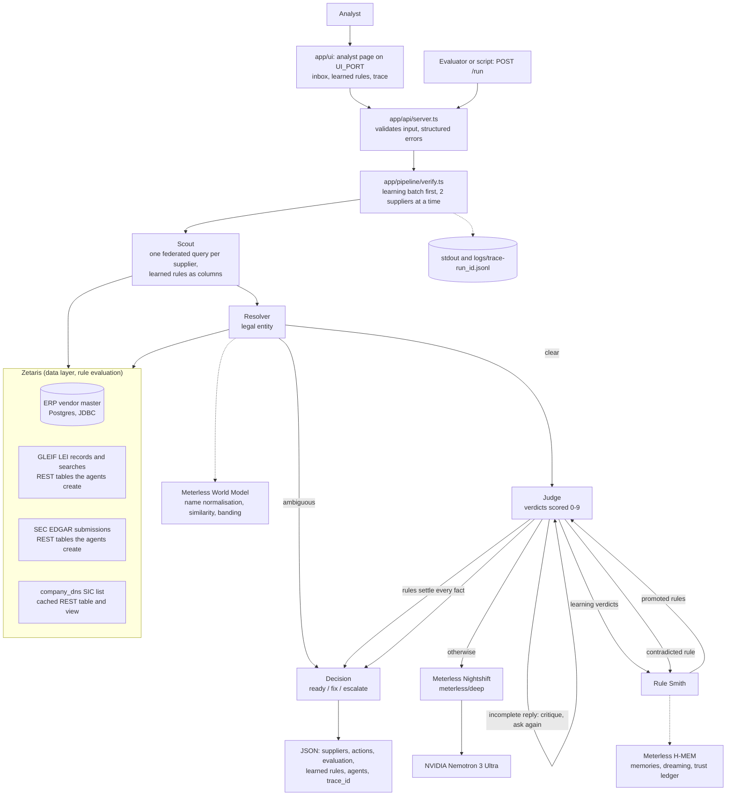
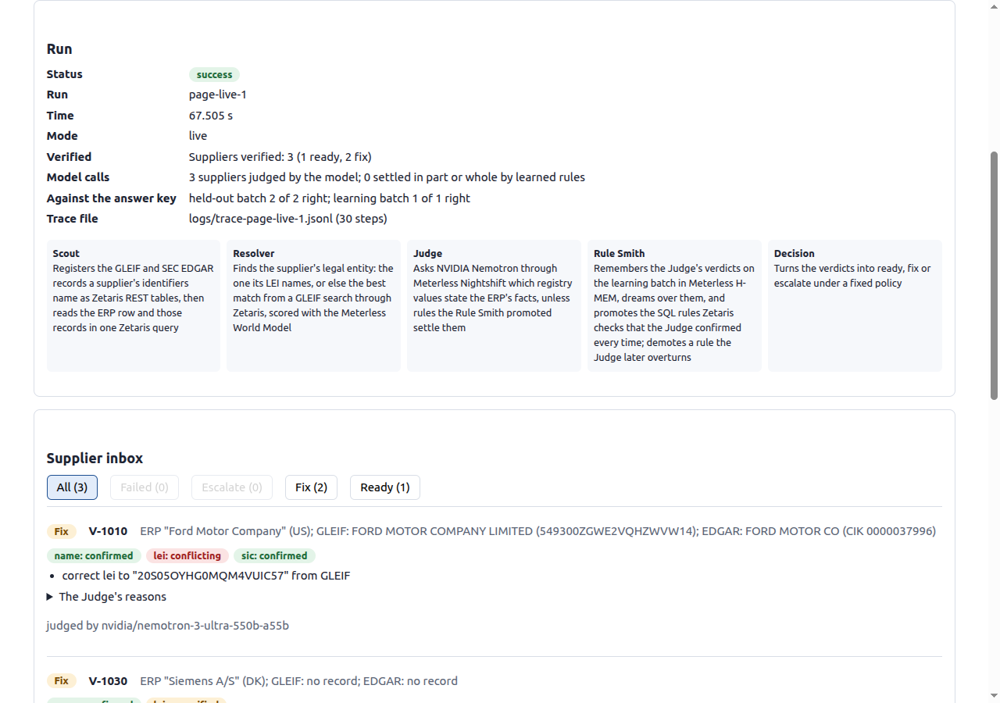

# Provenance

**Supplier-verification agents that turn their own proven judgments into SQL rules Zetaris enforces.**

> **Track:** 1, Solving Fragmented Intelligence. Open Agent Hackathon 2026.
>
> **Sponsor technology:** Zetaris (data layer), Meterless World Model and H-MEM engines, Meterless Nightshift
> (only AI provider), NVIDIA Nemotron 3 Ultra, built in Cursor.
>
> **Demo video (3:42):** <VIDEO_LINK> · **Slides:** [docs/Provenance-deck.pdf](docs/Provenance-deck.pdf)
>
> **Run it with only Docker installed:** `docker build -t provenance .` then
> `docker run --rm -p 8000:8000 -p 8001:8001 -e SAMPLE_MODE=true provenance`, then open
> <http://localhost:8001> or `curl -X POST localhost:8000/run -d @input_examples/example_3.json`.

## Contents

1. [The problem](#1-the-problem)
2. [What Provenance does](#2-what-provenance-does)
3. [Agents](#3-agents)
4. [How the agents work together](#4-how-the-agents-work-together)
5. [Rule Smith: learning rules from verdicts](#5-rule-smith-learning-rules-from-verdicts)
6. [Architecture](#6-architecture)
7. [Sponsor technology](#7-sponsor-technology)
8. [Quick start: sample mode](#8-quick-start-sample-mode)
9. [Full setup: live mode](#9-full-setup-live-mode)
10. [Usage](#10-usage)
11. [Logs and traces](#11-logs-and-traces)
12. [Tests](#12-tests)
13. [Data and licences](#13-data-and-licences)
14. [Failure handling and bounds](#14-failure-handling-and-bounds)
15. [Limitations](#15-limitations)
16. [Pre-existing components](#16-pre-existing-components)
17. [Repository layout](#17-repository-layout)

## 1. The problem

A **supplier onboarding analyst** in procurement must confirm each supplier before it goes into the ERP's vendor
master: its legal name, its Legal Entity Identifier (LEI), whether that registration is still active, and its
industry code. The answer is split across sources that disagree:

- the **ERP**, where staff typed names, LEIs and SIC codes by hand;
- **GLEIF**, the global LEI registry;
- **SEC EDGAR**, US company filings;
- **company_dns**, a list of US SIC industry codes.

They use different names ("Honeywell Intl" vs "HONEYWELL INTERNATIONAL INC."), formats (a CIK as `773840` or
`0000773840`) and codes (EDGAR files IBM under SIC 3570, a code the company_dns list lacks). Doing this by hand
is slow and repeated for every supplier, and a language model on its own invents agreement that isn't there.

## 2. What Provenance does

Give it ERP vendor IDs, typed-in suppliers (name, country and any identifiers), or nothing to check the whole
vendor master. For each supplier it returns:

- each **fact** (legal name, LEI, SIC code) as **confirmed**, **conflicting** or **unverified**, with the
  sources, the Judge's one-sentence reason and the model that gave it;
- one **decision**: **ready** (every fact holds), **fix** (a concrete action: correct field X to value Y from
  source Z, or request a document) or **escalate** (a real conflict, a lapsed registration or an ambiguous
  identity), for the analyst;
- the **rules** it learned, with the evidence for each, and how many suppliers they settled without a model call.

The agent recommends; the analyst decides. A supplier no registry covers (for example a small company in a
country with few LEIs) gets **fix: request a document**, never an escalation, so it is not penalised for the
registries' gaps.

What it catches on the 31-supplier ERP in this repository (`output_examples/example_3.json`):

| Supplier                      | ERP says                                     | Provenance finds                                                                                      | Decision                |
| ----------------------------- | -------------------------------------------- | ----------------------------------------------------------------------------------------------------- | ----------------------- |
| V-1002 Siemens AG (DE)        | LEI `5299008LSFRCSQJPMO62`                   | that LEI belongs to a same-name entity in another country; Siemens AG's own is `W38RGI023J3WT1HWRP32` | fix                     |
| V-1019 Honeywell Intl         | its name                                     | the legal name is HONEYWELL INTERNATIONAL INC.                                                        | fix                     |
| V-1001 IBM                    | SIC 3570                                     | EDGAR agrees, but the company_dns list has no code 3570                                               | escalate                |
| V-1012 Ford Motor Company A/S | its LEI                                      | the registration has LAPSED                                                                           | escalate                |
| V-1031 Ericsson (SE)          | a name, no identifiers                       | two registered legal entities match; neither can be chosen                                            | escalate                |
| V-1022 to V-1026              | small suppliers in Cameroon, Ghana and Kenya | no registry covers them                                                                               | fix: request a document |

Scored against a hand-labelled answer key (`data/answer-key.json`), a supplier counts as correct only with the
expected decision and exactly the expected corrections. The last live run scored **18/18 on the learning batch
and 13/13 on the held-out batch**.

## 3. Agents

| Agent          | Responsibility                                                                                                                                                                                               | Uses                                         | Can block or send back?                                                                  |
| -------------- | ------------------------------------------------------------------------------------------------------------------------------------------------------------------------------------------------------------ | -------------------------------------------- | ---------------------------------------------------------------------------------------- |
| **Scout**      | Registers the GLEIF and EDGAR records a supplier's identifiers name as Zetaris REST tables, then reads the ERP row, those records, the SIC list and the learned rules' results in one Zetaris query          | Zetaris                                      | Reports gaps (an invalid or unknown LEI, a malformed CIK) to the Resolver                |
| **Resolver**   | Finds the supplier's legal entity: the one its LEI names, or the best match from a GLEIF search through Zetaris, scored with the Meterless World Model                                                       | Zetaris, World Model                         | Hands an ambiguous identity straight to Decision, skipping the Judge                     |
| **Judge**      | Decides which registry values state the ERP's facts and scores each verdict 0–3 on accuracy, appropriateness and actionability; skips the model when promoted rules settle every fact                        | Nightshift → Nemotron 3 Ultra, learned rules | Critiques an incomplete model reply and asks again; a verdict scored under 7/9 escalates |
| **Rule Smith** | Remembers the Judge's verdicts on the learning batch in H-MEM, dreams over them, back-tests the rules they support and promotes those the Judge never contradicted; demotes a rule the Judge later overturns | H-MEM, Zetaris                               | Rejects a rule the Judge contradicted; demotes a promoted rule                           |
| **Decision**   | Turns the verdicts into ready, fix or escalate under one fixed policy (`app/domain/decide.ts`)                                                                                                               | none (deterministic)                         | Escalates conflicts, lapsed LEIs and low Judge scores                                    |

The Judge is the only agent that calls a model. Everything that can be settled by SQL, string rules or the
World Model is settled before a model is asked, and the model only sees curated rows.

## 4. How the agents work together

- **Shared evidence.** The Scout's single Zetaris query gives the Resolver, Judge and Rule Smith the same
  evidence, including which learned rules held for this supplier.
- **Identity before facts.** The Resolver decides which legal entity the facts are checked against. If the
  ERP's LEI names an entity in another country, the Resolver searches GLEIF and the Judge checks the facts
  against the right entity, so the wrong LEI becomes a correction rather than a confirmation.
- **Branching.** An ambiguous identity goes straight to Decision for escalation; a supplier whose facts are all
  settled by learned rules goes to Decision without a model call.
- **Critique and retry.** The Judge checks every model reply against the facts it was asked about; an
  incomplete reply is logged as `critique` (`needs_revision`) and asked once more. Zetaris and Nightshift calls
  are retried with backoff, and each retry is logged.
- **Learning and unlearning.** The Rule Smith learns from the Judge's verdicts, the Judge applies the promoted
  rules, and a rule the Judge later contradicts is demoted.
- **Graceful failure.** A supplier that fails is reported in its place, with the reason, and the run continues.

## 5. Rule Smith: learning rules from verdicts

Each rule is a boolean SQL expression. The Scout adds every rule its registries allow as a column of the
supplier's evidence query, so **Zetaris evaluates the rules**, and the agents only read `true`, `false` or null.

1. The answer key splits the suppliers into a **learning batch** (18) and a **held-out batch** (13), fixed
   before any rule existed. The learning batch runs first.
2. Each of the Judge's verdicts on a learning supplier becomes an **H-MEM memory**, tagged with its field and
   the rules that held for it, with the Judge's score as its confidence.
3. **H-MEM dreams** over those memories and proposes clusters. A rule that held for at least 3 verdicts in one
   cluster is **back-tested** against every learning verdict it held for: it is **promoted** if the Judge never
   contradicted it, and **rejected** otherwise. Promotions and dream approvals are written to H-MEM's trust ledger.
4. For the held-out suppliers, when promoted rules settle every fact the Judge **does not call the model**
   (`apply_rules` in the trace). When the model is asked, its verdict is checked against the rules, and a
   contradicted rule is **demoted**.

The library has five rule shapes, including a tempting wrong one (`name_shares_first_word`). In the last live
run (`output_examples/example_3.json`):

| Rule                       | SQL Zetaris evaluates                                                                                                | Result                                                              |
| -------------------------- | -------------------------------------------------------------------------------------------------------------------- | ------------------------------------------------------------------- |
| `name_is_gleif_legal_name` | `regexp_replace(upper(e.vendor_name), '[^A-Z0-9]', '') = regexp_replace(upper(g...legalName.name), '[^A-Z0-9]', '')` | promoted (7 verdicts)                                               |
| `lei_is_claimed_record`    | `e.claimed_lei = g.data.attributes.lei`                                                                              | promoted (10)                                                       |
| `sic_is_listed_edgar_code` | `e.claimed_sic = s.sic AND l.codes[s.sic] IS NOT NULL`                                                               | promoted (7)                                                        |
| `sic_missing_from_list`    | `s.sic IS NOT NULL AND l.codes[s.sic] IS NULL`                                                                       | promoted (3)                                                        |
| `name_shares_first_word`   | `split(upper(e.vendor_name), ' ')[0] = split(upper(g...legalName.name), ' ')[0]`                                     | **rejected**: the Judge contradicted it on V-1019, "Honeywell Intl" |

**Measured effect:** of the 13 held-out suppliers, 10 needed the Judge; the promoted rules settled **5 of those
10 without a model call**, and held-out accuracy stayed **13/13**.

## 6. Architecture



| Layer                | Technology                                                                                   |
| -------------------- | -------------------------------------------------------------------------------------------- |
| Language and runtime | TypeScript 6 (strict), Node 20.19+ (Docker: Node 24), run with `tsx`                         |
| API                  | Node's `http` module: `POST /run` on `0.0.0.0:$PORT`                                         |
| Analyst page         | HTML, CSS and type-checked JavaScript, no framework or build step, on `0.0.0.0:$UI_PORT`     |
| Data access          | Zetaris Lightning SQL over its REST API (`app/adapters/zetaris.ts`)                          |
| Model runtime        | Meterless Nightshift, OpenAI-format chat (`app/adapters/meterless.ts`)                       |
| Model                | NVIDIA Nemotron 3 Ultra (`nvidia/nemotron-3-ultra-550b-a55b`) on Nightshift's deep lane      |
| Engines              | Meterless World Model and H-MEM reference implementations (`app/engines/`)                   |
| Tests                | Vitest, the official engine conformance suites, ESLint (strict type-checked), Prettier, Knip |
| Container            | Docker, `node:24-slim`, runs as a non-root user                                              |

## 7. Sponsor technology

**Zetaris (data layer).** All ERP and registry data reaches the agents through Zetaris SQL; the app holds no
other database or registry client.

- The synthetic ERP is a Postgres database that Zetaris registers as a JDBC data source (`zetaris/setup/02_erp.sql`).
- The company_dns SIC list is a Zetaris REST table, exposed as a SchemaStore view and cached in Zetaris
  (`01_industry_codes.sql`).
- **The agents extend Zetaris while they run.** For each LEI or CIK it meets, the Scout issues
  `CREATE LIGHTNING REST TABLE` over the Zetaris REST API (a GLEIF record or an EDGAR submissions file), after
  checking `SHOW LIGHTNING TABLES`. The Resolver registers each GLEIF name search the same way. A judge's
  typed-in supplier therefore works live, not just the ERP's.
- One **federated query per supplier** joins the ERP row, its GLEIF record, its EDGAR filing and the SIC list,
  and computes every learned rule as a column. Zetaris is where the rules run.
- **What it saved us:** the app has no GLEIF or EDGAR client, no join code across four sources and no rule
  engine. Zetaris fetches, caches and joins the registries, and the learned rules are columns in that query.

**Meterless engines (two, both in working features, both passing the official conformance suites).**

- **World Model** powers the Resolver's entity matching: `normalizeName` and `nameSimilarity` score each GLEIF
  candidate, and `decide` bands the score (auto-merge, review or new). Our layer on top makes different legal
  forms never match (Siemens AG is not Siemens AB), and the trace logs each score and band.
- **H-MEM** powers the Rule Smith: the Judge's verdicts are memories with provenance (the vendor ID) and
  confidence (the Judge's score), `dreaming.dream()` proposes clusters, `dreaming.approve()` / `reject()`
  closes each proposal, and the trust ledger records every promotion and demotion. Each run's H-MEM state and
  ledger are saved to `logs/trace-<run_id>-hmem/`; `output_examples/example_3.hmem-ledger.jsonl` is one.
- **Test:** `npm run conformance` runs both official suites against our copies: H-MEM **13/13**, World Model
  **8/8**. Our own tests cover the layers we built on them (`tests/unit/resolver.test.ts`,
  `tests/unit/ruleSmith.test.ts`).

**Meterless Nightshift (the only AI provider).** Every model call goes to Nightshift's OpenAI-format
`/v1/chat/completions` with the Runtime token, `meterless-app: provenance` and `meterless-scope: user`, on the
`meterless/deep` route. The app follows Nightshift's Runtime 1.4 provider contract: URL normalisation, status
from `/v1/models` (`npm run meterless:check`), a 90 s timeout, retries on 429 after 2, 4 and 8 s, and
Nightshift's own error message and `fix` steps surfaced to the user. The app holds no NVIDIA key; it lives in
Nightshift's Providers tab.

**NVIDIA.** The Judge's verdicts come from **NVIDIA Nemotron 3 Ultra**
(`nvidia/nemotron-3-ultra-550b-a55b`), pinned to Nightshift's deep lane: it separates "same fact, different
words" (Corp = Corporation, an English filing name) from real conflicts, and scores its own verdicts. Every
model request is logged with the model that answered, taken from Nightshift's response, both in the trace
(`"model": "nvidia/nemotron-3-ultra-550b-a55b"`) and in each supplier's result. `npm run meterless:check` also
sends one request on the fast lane and prints the model that answered it; no agent uses that lane.

**Cursor (with Space XAI).** Provenance was built in Cursor with its coding agent, in small slices planned in
chat and reviewed before each commit:

- **Against the real services.** The agent worked out the Zetaris Lightning SQL the app relies on (REST tables
  over GLEIF and EDGAR, `SHOW LIGHTNING TABLES` before `CREATE`, JSON paths into the records) by running it
  against the local Zetaris with `npm run sql`, and checked Nightshift's provider contract with
  `npm run meterless:check`, so the adapters match what the services do rather than what we guessed.
- **Tests first-class.** It wrote the unit tests, wired in both official Meterless conformance suites, and
  mutation-tested each new piece of logic; `npm run check` passed before every commit.
- **The analyst page.** It checked the page in Cursor's browser, including keyboard use and a phone-sized
  screen, and fixed the review comments on each pull request.
- **Our part.** We set the design, reviewed and tested every change, and merged through pull requests. Secrets
  stayed in local environment files that were never printed or committed.

**What was unique.** The agents **distil their own judgments into governed SQL**. The model's verdicts are not
just answers: H-MEM remembers them, the Rule Smith turns the patterns they confirm into SQL that Zetaris runs
inside the agents' own queries, and the next suppliers need fewer model calls. Rules are promoted only after a
back-test against every verdict, a tempting wrong rule is visibly rejected, a promoted rule is demoted if the
model later overturns it, and the effect is measured on held-out suppliers. Zetaris is not just a pipe: the
agents add sources to it at runtime and it evaluates what they learn.

## 8. Quick start: sample mode

Sample mode replays recorded Zetaris answers and Nightshift replies for the 31 ERP suppliers and the two
typed-in suppliers of `input_examples/example_4.json`. It needs **no Zetaris, no Nightshift, no network and no
`.env`**. Everything else is real: the Resolver, the World Model scoring, the Judge's checks, the Rule Smith
with H-MEM, the decisions and the evaluation. A supplier outside the recording is reported with a structured
error, never a guess.

With Docker:

```bash
git clone https://github.com/Vitalisn4/provenance.git && cd provenance
docker build -t provenance .
docker run --rm -p 8000:8000 -p 8001:8001 -e SAMPLE_MODE=true provenance
```

Or with Node 20.19 or later:

```bash
npm ci
SAMPLE_MODE=true npm start
```

Then open the analyst page at <http://localhost:8001>, choose example 3 and press **Verify**. Or, from another
terminal:

```bash
curl -X POST http://localhost:8000/run -H 'content-type: application/json' -d @input_examples/example_3.json
```

Example 3 verifies all 31 suppliers, learns the rules and scores itself in under a second, with the same
result as the live run. On a live server, a single request can ask for sample mode with
`"options": { "sample_mode": true }`.

## 9. Full setup: live mode

### Dependencies

- **Docker**, with at least 8 GB of memory and 4 CPUs for Zetaris.
- **Node.js 20.19 or later**, for the one-off Zetaris setup command. The app's only runtime npm package is `tsx`,
  which runs the TypeScript; everything else is Node's standard library. The development tools, including the
  headless browser the page's tests run in, are in `package.json`.
- **Zetaris** running locally: follow "Install Zetaris locally" in the Participant Setup Guide. You need its REST
  URL, org ID and an API key.
- **Meterless Nightshift**: install it as in the Participant Setup Guide, add NVIDIA in its **Providers** tab with
  your NVIDIA API key, and pin the deep lane to Nemotron 3 Ultra (`nemotron-3-ultra-550b-a55b`); the app uses
  only the deep lane. Copy the **Runtime token** from its Console. Nightshift runs on Windows or macOS; from
  Linux, reach a Nightshift on another machine through an SSH tunnel to `127.0.0.1:8088`
  (`ssh -N -L 8088:127.0.0.1:8088 <host>`), which is how this project was built.
- **No Google Colab.** The agents run in the Node process (or its Docker container); there are no notebooks.

### Steps

```bash
git clone https://github.com/Vitalisn4/provenance.git && cd provenance
cp .env.example .env    # fill in the Zetaris and Nightshift values, SEC_USER_AGENT and ERP_DB_PASSWORD
npm ci

# The synthetic ERP: a small Postgres container on Zetaris's Docker network (zetaris_default)
docker compose up -d erp-db

# Registers the ERP, the SIC list and the registry databases in Zetaris; safe to re-run
npm run zetaris:setup

# Checks Nightshift: status, models, and one short request per lane with the model that answered
npm run meterless:check

npm start               # serves POST /run on port 8000 and the analyst page on port 8001
```

The GLEIF and EDGAR tables are created by the agents during the first run, so the first live run of example 3
takes longer than later ones.

### Live mode in Docker

Zetaris and Nightshift run outside the app's container, where `localhost` means the container itself.

- **macOS and Windows (Docker Desktop):** in `.env`, use `ZETARIS_REST_URL=http://host.docker.internal:8888/api/v1.0`
  and `METERLESS_BASE_URL=http://host.docker.internal:8088/v1`, then

  ```bash
  docker run --rm -p 8000:8000 -p 8001:8001 --env-file .env provenance
  ```

- **Linux:** keep the `localhost` and `127.0.0.1` addresses and share the host's network, which also reaches an
  SSH tunnel listening on `127.0.0.1`:

  ```bash
  docker run --rm --network host --env-file .env provenance
  ```

### Settings

| Variable                                                | Purpose                                                                                           |
| ------------------------------------------------------- | ------------------------------------------------------------------------------------------------- |
| `ZETARIS_REST_URL`, `ZETARIS_ORG_ID`, `ZETARIS_API_KEY` | Zetaris's REST API                                                                                |
| `METERLESS_BASE_URL`, `METERLESS_RUNTIME_TOKEN`         | Nightshift's URL and Runtime token (never the `rt-local` placeholder)                             |
| `SEC_USER_AGENT`                                        | An app name and contact email, which SEC EDGAR's fair-access policy requires on every request     |
| `ERP_DB_PASSWORD`                                       | The synthetic ERP database's password, used by `docker compose` and `npm run zetaris:setup`       |
| `SAMPLE_MODE`                                           | `true` replays the recording with no Zetaris, Nightshift or network                               |
| `PORT`                                                  | The port `POST /run` is served on (default 8000)                                                  |
| `UI_PORT`                                               | The port the analyst page is served on (default 8001)                                             |
| `API_TOKEN`                                             | Optional: when set, `POST /run` and the page's traces require `Authorization: Bearer <API_TOKEN>` |

Settings are read from the environment, then `.env`; values already in the environment win. Secrets are masked
as `...redacted` in every log line.

## 10. Usage

### Analyst page

`npm start` also serves the analyst page on `UI_PORT` (default 8001), a port of its own so a long run never holds
up the API. Pick an example or edit the request, choose sample or live mode, and press **Verify**. The page shows:

- **The run:** status, time, the decision counts, how many suppliers the model judged and how many learned rules
  settled, and the score against the answer key.
- **The supplier inbox:** each supplier's decision, the status of each fact, the actions to take, the Judge's
  reasons, the evidence Zetaris returned, and whether the model or a learned rule decided it. Filter by
  Escalate, Fix or Ready.
- **The learned rules:** each rule's status, support, reason and SQL.
- **The trace:** every step of the run, filterable by supplier, with each Zetaris query and the model that answered.



The page sends its request to the API through its own server, so it needs no access across origins. It inserts
every value from a run as text, and its content security policy allows only its own script and stylesheet, with
no inline code. With `API_TOKEN` set, enter the token on the page. It works from the keyboard alone and on a
phone-sized screen, where the wide tables scroll within their own panels.

### `POST /run`

```json
{
  "run_id": "example-4",
  "input": {
    "vendor_ids": ["V-1003", "V-1010"],
    "suppliers": [{ "name": "Apple Inc.", "country": "US", "cik": "320193", "sic": "3571" }]
  },
  "options": { "sample_mode": false }
}
```

- `input.vendor_ids`: ERP vendor IDs (`V-1001` to `V-1031`). With neither list, every ERP supplier is verified.
- `input.suppliers`: up to 10 typed-in suppliers: `name` and a two-letter `country` are required; `lei`, `cik`
  and `sic` are optional, as an ERP record would hold them.
- `run_id` (optional) names the trace file; `options.sample_mode` overrides `SAMPLE_MODE` for one request.

### Examples

| Input            | What it shows                                                                           | Live time |
| ---------------- | --------------------------------------------------------------------------------------- | --------- |
| `example_1.json` | Three ERP suppliers: one ready, two LEI corrections                                     | 82 s      |
| `example_2.json` | IBM's disputed SIC code, a lapsed LEI and an ambiguous identity                         | 59 s      |
| `example_3.json` | The whole ERP: learning, rule promotion and rejection, held-out scoring                 | 7.7 min   |
| `example_4.json` | Two typed-in suppliers, Apple and Nestlé, found through Zetaris from a name and country | 25 s      |

Each output in `output_examples/` was saved from a live run, with its trace next to it. Learning needs at
least 3 supporting verdicts per rule, so rules are promoted only in example 3, which includes the whole learning
batch.

### Response

```json
{
  "run_id": "example-3",
  "status": "success",
  "output": {
    "sample_mode": false,
    "summary": "Suppliers verified: 31 (11 escalate, 16 fix, 4 ready)",
    "recommendations": ["V-1019: correct name to \"HONEYWELL INTERNATIONAL INC.\" from GLEIF", "..."],
    "suppliers": [
      {
        "vendorId": "V-1019",
        "decision": "fix",
        "facts": [{ "field": "name", "status": "confirmed" }, "..."],
        "actions": [
          { "kind": "correct", "field": "name", "value": "HONEYWELL INTERNATIONAL INC.", "source": "GLEIF" }
        ],
        "reasons": {
          "name": "ERP value 'Honeywell Intl' abbreviates 'International' and omits the legal form ..."
        },
        "model": "nvidia/nemotron-3-ultra-550b-a55b",
        "rules": []
      }
    ],
    "evaluation": { "learning": { "correct": 18, "total": 18 }, "held_out": { "correct": 13, "total": 13 } },
    "learning": { "rules": ["..."], "suppliers_judged_by_model": 20, "suppliers_settled_by_rules": 5 }
  },
  "agents": [{ "name": "Scout", "role": "..." }, "..."],
  "trace_id": "trace-example-3-75654f80",
  "log_file": "logs/trace-example-3-75654f80.jsonl",
  "execution_time_seconds": 464.323
}
```

`status` is `partial` when some suppliers failed; each failed supplier carries an `error` in its place. A
request that cannot run returns a structured error with an HTTP status: 400 for bad input, 401 for a missing or
wrong `API_TOKEN`, 404 for any other path, 502 when Zetaris fails before any supplier is verified, 503 for missing
settings.

```json
{
  "run_id": "bad",
  "status": "error",
  "error": { "type": "input", "message": "Not in the ERP: V-9999", "recoverable": false },
  "trace_id": "trace-bad",
  "log_file": "logs/trace-bad.jsonl",
  "execution_time_seconds": 0.005
}
```

### Command line

| Command                                                 | What it does                                                             |
| ------------------------------------------------------- | ------------------------------------------------------------------------ |
| `npm run verify -- V-1001 V-1019`                       | Verifies suppliers (or all, with no IDs) and prints the results as JSON  |
| `npm run evaluate -- results.json`                      | Scores saved `verify` results against the answer key, listing every miss |
| `npm run scout -- V-1001` / `npm run resolve -- V-1001` | Runs the Scout or the Resolver alone                                     |
| `npm run sql -- "SHOW LIGHTNING TABLES prov_gleif"`     | Runs one Zetaris SQL statement                                           |
| `npm run sample:record`                                 | Re-records `data/sample/recording.json` from a live run                  |

## 11. Logs and traces

Every step is printed to stdout and appended to `logs/trace-<run_id>.jsonl`, one JSON object per line, in the
Technical Execution Guide's format: `timestamp`, `run_id`, `vendor_id`, `agent_name`, `action`, `input_summary`,
`output_summary`, `target_agent`, `model`, `confidence`, `retry_count`, `status`.

The trace shows each Zetaris query and its row count, each table the agents register, the World Model's scores,
each Nightshift request with the route asked for and **the model that answered**, the Judge's verdicts,
critiques and retries, the Rule Smith's dreaming, back-tests and demotions, and each decision. From
`output_examples/example_3.trace.jsonl`:

```text
[INFO] run_id=example-3 Pipeline start -> Scout: 31 of 31 ERP suppliers, 2 at a time; the 18 in the learning batch first
[INFO] run_id=example-3 vendor=V-1019 Scout gather_evidence -> Resolver: ERP "Honeywell Intl" (US); GLEIF: HONEYWELL INTERNATIONAL INC. (ISRPG12PN4EIEOEMW547); EDGAR: HONEYWELL INTERNATIONAL INC (CIK 0000773840)
[INFO] run_id=example-3 vendor=V-1019 Judge nightshift_chat: 1174 characters in 7.9 s (model: nvidia/nemotron-3-ultra-550b-a55b)
[INFO] run_id=example-3 vendor=V-1019 Decision decide: fix; correct name to "HONEYWELL INTERNATIONAL INC." from GLEIF
[INFO] run_id=example-3 Pipeline learn -> Rule Smith: 18 learning suppliers verified
[INFO] run_id=example-3 Rule Smith back_test: name_shares_first_word rejected: the Judge contradicted it on V-1019 (confidence 0.88)
[INFO] run_id=example-3 vendor=V-1003 Judge apply_rules -> Decision: learned rules settled every fact, so the model was not asked: name_is_gleif_legal_name, lei_is_claimed_record
[INFO] run_id=example-3 Pipeline finish: 11 escalate, 16 fix, 4 ready
```

In Docker, read the trace with `docker cp <container>:/app/logs .`; stdout already carries every step.

## 12. Tests

```bash
npm run check          # typecheck, lint, unused code, formatting, 178 unit tests, both engine conformance suites
npm run conformance    # the official Meterless suites alone: H-MEM 13/13, World Model 8/8
```

The unit tests cover every agent, the decision policy, the scoring, the API's contract and errors, the analyst
page's server and its script (run in a headless browser against the real server), retries and timeouts, sample
mode (a full offline replay asserts the learned rules and the suppliers they settle) and a secrets scan of every
tracked file. The new logic of each slice was mutation-tested, and every mutant that changes behaviour was killed.

## 13. Data and licences

| Source                                                                                               | What it gives                                                                            | Licence                                                    | How it is used                                                  |
| ---------------------------------------------------------------------------------------------------- | ---------------------------------------------------------------------------------------- | ---------------------------------------------------------- | --------------------------------------------------------------- |
| Synthetic ERP vendor master, `data/erp/01_vendor_master.sql`                                         | 31 suppliers as staff typed them, with real and seeded errors                            | Ours, synthetic                                            | Postgres container, registered in Zetaris                       |
| [GLEIF LEI API](https://www.gleif.org/en/lei-data/gleif-api)                                         | Legal names, countries, registration status                                              | CC0                                                        | Queried live through Zetaris REST tables                        |
| [SEC EDGAR submissions](https://www.sec.gov/search-filings/edgar-application-programming-interfaces) | Company names, CIKs, SIC codes                                                           | US public data                                             | Queried live through Zetaris REST tables, with `SEC_USER_AGENT` |
| [company_dns](https://github.com/miha42-github/company_dns) SIC list                                 | The US SIC code list                                                                     | Apache-2.0                                                 | One cached Zetaris REST table                                   |
| `data/answer-key.json`                                                                               | The expected decision and corrections for each supplier, and the learning/held-out split | Ours, hand-labelled against GLEIF and EDGAR on 23 Oct 2026 | Scoring and the learning batch                                  |
| `data/sample/recording.json`                                                                         | Recorded Zetaris answers and Nightshift replies                                          | Derived from the above                                     | Sample mode                                                     |

The ERP rows are synthetic: 26 name real registered companies and 5 are fictional small suppliers
(V-1022 to V-1026). The answer key labels each error's origin: `real` (found in the registries), `seeded`
(typed into the ERP on purpose) or `synthetic` (the fictional suppliers). There is no personal data. All data
is kilobytes; nothing is downloaded in bulk. To regenerate the sample: run live, then `npm run sample:record`.

## 14. Failure handling and bounds

| Situation                              | Behaviour                                                                                        |
| -------------------------------------- | ------------------------------------------------------------------------------------------------ |
| Zetaris times out or answers 5xx       | 60 s timeout per request, 2 retries after 0.5 s and 1 s, then the supplier is reported as failed |
| Nightshift rate-limits (429) or fails  | 90 s timeout, retries after 2, 4 and 8 s, then the supplier is reported as failed                |
| Nightshift rejects the token           | No retry; the error says where the Runtime token comes from                                      |
| The model's reply is incomplete        | Logged as a critique and asked once more, then the supplier is reported as failed                |
| A Zetaris result reaches its row limit | Treated as an error rather than silently truncated data                                          |
| One supplier fails                     | Reported in its place; the others complete and `status` is `partial`                             |
| Bad input                              | 400 with the field at fault; bodies over 64 KB and more than 10 typed suppliers are refused      |
| Missing settings                       | 503 naming the setting, pointing at `.env.example`                                               |

Two suppliers are verified at a time, because at four NVIDIA's rate limit refused Ultra calls even after the
retries. A full 31-supplier run takes about 8 minutes live and seconds in sample mode. Every threshold, with its
source, is in `app/config/policy.ts`.

## 15. Limitations

- **The rule library is fixed.** The Rule Smith chooses which of five hand-written rule shapes to promote,
  reject or demote; it does not write new SQL.
- **Dreaming forms broad clusters.** H-MEM's reference embedder is deterministic and lexical, and the verdicts
  share their wording, so in example 3 all 40 verdicts formed one cluster. The selection is done by the
  back-test, which needs 3 supporting verdicts and no contradiction.
- **Learning happens within a run.** Rules are learned from the learning batch and applied to the rest of the
  same request; each run starts with an empty H-MEM. Smaller requests than example 3 usually lack 3 supporting
  verdicts, so they promote no rules.
- **Rules run inside the evidence query**, not as registered Zetaris data-quality rules.
- **Coverage.** Legal name, LEI and SIC code only: no addresses, ownership, sanctions or PEP screening. EDGAR covers
  US filers only, and the SIC list is US-only.
- **A small evaluation.** 31 suppliers, labelled by us; the accuracy figures show the system works on this set,
  not that it generalises.
- **Model speed.** Nemotron 3 Ultra takes 5–60 s per verdict and is rate-limited, hence two suppliers at a time.
- **The analyst page only reports.** Accepting a correction still means editing the ERP; nothing is written back.
- **Nightshift has no Linux build**, so on Linux it runs on another machine, reached through an SSH tunnel.

## 16. Pre-existing components

- `app/engines/hmem/src` and `app/engines/world-model/src`: the Meterless H-MEM and World Model reference
  implementations (Apache-2.0), copied unchanged from
  [Meterless/Meterless](https://github.com/Meterless/Meterless) at commit `1742dec`, with their licences, and the
  official conformance suites in `tests/conformance/` from the same commit. See `app/engines/README.md`.
- `zetaris/setup/01_industry_codes.sql` adapts the company_dns script from
  [zetaris/getting-started](https://github.com/zetaris/getting-started).

Everything else, including the synthetic ERP and the answer key, was written during the build window
(22–27 October 2026).

## 17. Repository layout

```text
app/
  adapters/        Zetaris and Nightshift clients, HTTP retries, sample-mode replay
  agents/          Scout, Resolver, Judge, Rule Smith and the rule library
  api/server.ts    POST /run
  cli/             npm run commands
  config/          settings (env.ts) and every threshold with its source (policy.ts)
  domain/          types, the decision policy, errors, LEI checks
  engines/         Meterless H-MEM and World Model (pre-existing, unchanged)
  evaluation/      scoring against the answer key
  pipeline/        the run: order, concurrency, trace
  ui/              the analyst page (page/: HTML, CSS and script) and its server
data/              synthetic ERP, answer key, sample recording
zetaris/setup/     the SQL that registers the static sources in Zetaris
input_examples/    four requests
output_examples/   their live responses, traces, and example 3's H-MEM trust ledger
tests/             unit tests and the official conformance suites
docs/              the slide deck (Provenance-deck.pdf) and the analyst-page screenshot
Dockerfile, docker-compose.yml, .env.example, metadata.json
```
